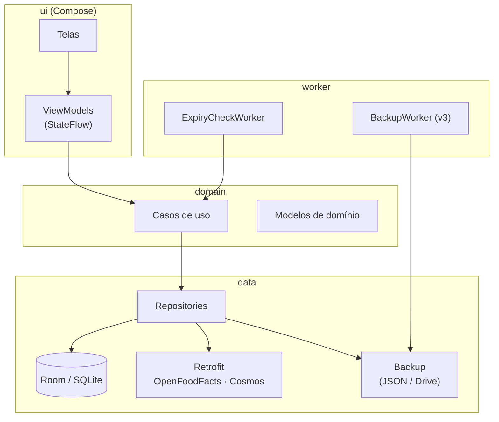
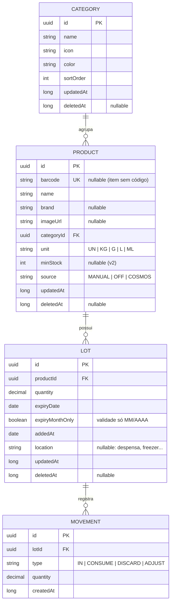
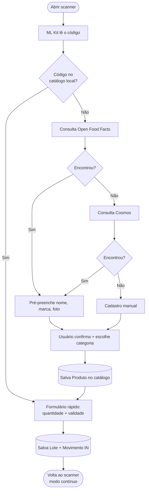

# my_storage — Arquitetura

> App Android para gestão do estoque de comida em casa: cadastro por código de barras, categorias e alerta de validade próxima.
>
> **Status:** desenho / pré-implementação · **Última revisão:** 2026-11-06

---

## 1. Visão geral

### Problema
Manter um estoque de comida em casa exige controle de validade. Sem isso, produtos vencem esquecidos no fundo da despensa.

### Objetivo
Um app **simples, rápido e offline** onde:

1. Adiciono um produto ao estoque **apenas lendo o código de barras**.
2. Organizo o estoque por **categorias**.
3. Sou **notificado** quando algo estiver a **60 dias (configurável)** de vencer.
4. Dou baixa no consumo, com sugestão de usar **primeiro o que vence antes** (FIFO por validade).
5. **Não perco os dados** ao trocar de celular (backup no Google Drive).

### Escopo
- **Plataforma:** somente Android (uso pessoal; eventual publicação na Play Store, ainda só Android).
- **Usuários:** inicialmente um único aparelho. Multi-dispositivo / família fica para a v3.

---

## 2. Conceito-chave: Produto ≠ Lote

O código de barras comum (EAN-13 / EAN-8 / UPC) identifica o **produto**, **não a validade**.
Dois pacotes do mesmo arroz comprados em meses diferentes têm o **mesmo código** e **validades diferentes**.

Por isso o modelo separa:

| Conceito | O que é | Exemplo |
|---|---|---|
| **Produto** | Item do catálogo, cadastrado **uma vez** por código de barras | "Arroz Tio João 5kg" — `7893500020110` |
| **Lote** | O que está fisicamente na despensa: quantidade + validade | 2 un · vence 03/2027 |

Consequência para a UX: a **segunda vez** que um produto é escaneado, ele já está no catálogo local → o usuário só informa **quantidade + validade** (~3 segundos).

---

## 3. Stack técnica

| Camada | Tecnologia | Motivo |
|---|---|---|
| Linguagem | **Kotlin** | JVM, padrão do Android moderno |
| UI | **Jetpack Compose** + **Material 3** | UI declarativa, tema dinâmico |
| Navegação | **Navigation Compose** (type-safe routes) | |
| Arquitetura | **MVVM** + Clean leve (`ui` / `domain` / `data`) | Simples e testável |
| Estado | **ViewModel** + **StateFlow** + Coroutines | |
| DI | **Hilt** | |
| Persistência | **Room** (SQLite) | Offline-first, `Flow` reativo |
| Preferências | **DataStore** (Preferences) | Prazo do alerta, horário do resumo |
| Câmera | **CameraX** | |
| Leitura de código | **ML Kit Barcode Scanning** (on-device) | Gratuito, offline, rápido |
| HTTP | **Retrofit** + **OkHttp** + **kotlinx.serialization** | |
| Imagens | **Coil** | |
| Jobs em background | **WorkManager** | Alertas diários e backup; sobrevive a reboot |
| Build | **Gradle KTS** + **Version Catalog** (`libs.versions.toml`) | |
| Testes | JUnit 5, MockK, Turbine, Room in-memory, Compose UI Test | |

**SDK:** `minSdk 26` · `targetSdk` / `compileSdk` = mais recente estável.

---

## 4. Arquitetura em camadas



**Regras:**
- `ui` só conhece `domain`. Nunca acessa DAO ou Retrofit diretamente.
- `domain` é Kotlin puro (sem dependência do Android), fácil de testar.
- `data` implementa as interfaces de repositório definidas em `domain`.

### Estrutura de pacotes

```
com.mystorage
 ├─ ui/
 │   ├─ home/          → dashboard (vencendo / vencidos / resumo)
 │   ├─ stock/         → lista do estoque, filtros
 │   ├─ scanner/       → câmera + formulário rápido
 │   ├─ product/       → detalhe do produto e seus lotes
 │   ├─ categories/    → CRUD de categorias
 │   ├─ settings/      → prazo do alerta, horário, backup
 │   ├─ components/    → componentes reutilizáveis (ExpiryBadge, etc.)
 │   └─ theme/
 ├─ domain/
 │   ├─ model/         → Product, Lot, Category, Movement, ExpiryStatus
 │   ├─ repository/    → interfaces
 │   └─ usecase/       → AddLot, ConsumeLot, DiscardLot, LookupBarcode,
 │                       GetExpiringLots, ExportBackup, ImportBackup
 ├─ data/
 │   ├─ local/         → entities, DAOs, AppDatabase, migrations
 │   ├─ remote/        → OpenFoodFactsApi, CosmosApi, DTOs
 │   ├─ backup/        → BackupSerializer, BackupFileManager
 │   └─ repository/    → implementações
 ├─ worker/            → ExpiryCheckWorker, WorkScheduler
 ├─ notification/      → canais, builders
 └─ di/                → módulos Hilt
```

---

## 5. Modelo de dados



### Decisões
- **IDs UUID** (não autoincrement) e colunas **`updatedAt` / `deletedAt`** (soft delete) em todas as entidades. Custa quase nada agora e deixa a sincronização (v3) viável sem migração dolorosa.
- **Validade mês/ano:** muitas embalagens trazem só `MM/AAAA`. Nesse caso `expiryDate` = último dia do mês e `expiryMonthOnly = true` (para exibição).
- **Lote com `quantity = 0`** é considerado esgotado e sai da lista principal (fica no histórico).
- **Produto sem código de barras** (hortifrúti, granel) é permitido: `barcode = null`.
- **`ExpiryStatus`** é calculado, não persistido:

| Status | Regra (padrão) | Cor |
|---|---|---|
| `OK` | > 60 dias | Verde |
| `WARNING` | ≤ 60 dias | Amarelo |
| `CRITICAL` | ≤ 7 dias | Laranja |
| `EXPIRED` | < hoje | Vermelho |

### Categorias padrão (seed)
Grãos e Cereais · Massas · Enlatados e Conservas · Molhos e Temperos · Óleos e Gorduras · Açúcares e Doces · Bebidas · Laticínios · Congelados · Higiene e Limpeza · Outros

---

## 6. Fluxo principal: escanear e adicionar



**Detalhes de UX:**
- **Modo contínuo:** após salvar, volta à câmera, ideal para descarregar as compras do mercado.
- **Feedback** de vibração + som ao ler um código.
- **Seletor de validade** com atalho para mês/ano.
- **Sem internet:** pula direto para o cadastro manual.

### APIs de produto

| API | Custo | Observação |
|---|---|---|
| **Open Food Facts** `world.openfoodfacts.org/api/v2/product/{ean}` | Gratuita, sem token | Base aberta; cobertura razoável no Brasil. Exige `User-Agent` identificando o app. |
| **Cosmos (Bluesoft)** `api.cosmos.bluesoft.com.br/gtins/{ean}` | Token; plano grátis limitado | Base brasileira de GTIN, cobertura melhor. Usado como reserva. |

O resultado é **sempre cacheado no catálogo local**: cada código é consultado na API uma única vez.

---

## 7. Notificações de validade

**Mecanismo:** `PeriodicWorkRequest` do WorkManager, **1x por dia** (horário configurável, padrão 09:00).

```
ExpiryCheckWorker
  1. Lê prazo configurado (padrão 60 dias) do DataStore
  2. Busca lotes ativos com expiryDate <= hoje + prazo
  3. Identifica quem CRUZOU um marco desde a última execução: 60d · 30d · 7d · venceu
  4. Se houver novidades → 1 notificação agrupada
       "4 itens vencendo em breve · 1 vencido"
       (toque abre a Home já filtrada)
  5. Salva data da última execução
```

- Notifica **só quando cruza um marco**, sem repetir o mesmo aviso todo dia.
- Canal de notificação próprio: `expiry_alerts`.
- Android 13+: pede a permissão `POST_NOTIFICATIONS` no onboarding.
- O WorkManager reagenda sozinho após reboot.

---

## 8. Backup e sincronização

Estratégia em níveis, do mais barato ao mais completo:

| Nível | O quê | Esforço | Versão |
|---|---|---|---|
| **1. Auto Backup do Android** | O sistema salva o banco Room no Google Drive da conta do aparelho e restaura ao reinstalar / trocar de celular | Configuração no manifest + `backup_rules.xml` | **v1** |
| **2. Exportar / Importar JSON** | Botão gera `my_storage_backup_AAAA-MM-DD.json` e abre o seletor de arquivos do sistema (SAF). Dá para salvar **direto no Google Drive**, sem OAuth nem API | ~meio dia | **v1** |
| **3a. Backup automático no Drive** | Drive API (`appDataFolder`) + Google Sign-In + `BackupWorker` periódico | Moderado (OAuth no Cloud Console) | v3 (opcional) |
| **3b. Sync real (Firestore)** | Multi-dispositivo / família, offline cache, tempo real | Alto (conflitos, fonte da verdade) | v3 (se mais alguém usar) |

### Formato do backup (nível 2)
```json
{
  "schemaVersion": 1,
  "exportedAt": "2026-11-06T10:00:00Z",
  "categories": [ ... ],
  "products":   [ ... ],
  "lots":       [ ... ],
  "movements":  [ ... ]
}
```
- `schemaVersion` permite importar backups antigos após migrações.
- **Importar** = substituir tudo (com confirmação). Merge por `updatedAt` pode vir depois.

### Preparação para sync (já na v1)
UUIDs + `updatedAt` + `deletedAt` em todas as entidades → estratégia *last-write-wins* por registro quando a v3 chegar.

---

## 9. Telas

| Tela | Conteúdo |
|---|---|
| **Home** | Cards "Vencidos", "Vencendo em 7 dias", "Vencendo em 60 dias"; resumo por categoria; FAB **Escanear** |
| **Estoque** | Lista agrupada por produto (quantidade total + validade mais próxima), busca, filtro por categoria/status, ordenação por validade |
| **Scanner** | Câmera em tela cheia com mira, lanterna, entrada manual de código; modo contínuo |
| **Formulário rápido** | Produto (pré-preenchido), quantidade (stepper), validade (dia ou mês/ano), local |
| **Produto** | Foto, dados, lista de lotes com `ExpiryBadge`; ações **Consumir** (sugere o lote que vence primeiro), **Descartar**, editar |
| **Categorias** | CRUD, ícone e cor |
| **Configurações** | Prazo do alerta (padrão 60), horário do resumo, exportar/importar backup, sobre |

---

## 10. Roadmap

### v1 — MVP
- [x] Setup do projeto (Compose, Hilt, Room, Version Catalog)
- [x] Modelo de dados + migrations + seed de categorias
- [x] Scanner (CameraX + ML Kit) com modo contínuo
- [x] Lookup Open Food Facts → Cosmos → manual, com cache local
- [ ] CRUD de produtos, lotes e categorias
- [ ] Consumo / descarte com sugestão FIFO por validade
- [ ] Home com alertas + tela de estoque com filtros
- [x] `ExpiryCheckWorker` + notificação agrupada
- [x] Configurações (prazo, horário)
- [ ] Auto Backup + exportar/importar JSON

### v2
- [ ] Histórico de movimentações e estatísticas (consumido × descartado)
- [ ] Estoque mínimo por produto → **lista de compras** automática
- [ ] Widget na tela inicial com itens vencendo

### v3
- [ ] Backup automático no Drive (`appDataFolder`) **ou** sync com Firestore
- [ ] OCR da data de validade (ML Kit Text Recognition)
- [ ] Publicação na Play Store

---

## 11. Decisões registradas (ADR resumido)

| # | Decisão | Alternativas consideradas | Motivo |
|---|---|---|---|
| 1 | Android nativo (Kotlin + Compose) | React Native/Expo, Flutter, PWA | Só Android; dev com background Java; melhor acesso a câmera/WorkManager |
| 2 | Offline-first com Room, sem backend | Supabase, Firebase desde o início | Uso pessoal; zero custo e zero infraestrutura |
| 3 | ML Kit on-device para código de barras | ZXing | Mais rápido e preciso, mantido pelo Google |
| 4 | Produto separado de Lote | Item único com validade | O mesmo EAN tem várias validades |
| 5 | WorkManager diário em vez de alarmes por lote | AlarmManager por item | Menos agendamentos, resistente a reboot, notificação agrupada |
| 6 | Backup em níveis (Auto Backup + SAF) | Drive API já na v1 | Resolve perda de dados sem OAuth |
| 7 | UUID + soft delete desde a v1 | Autoincrement | Viabiliza sync futuro sem migração pesada |
